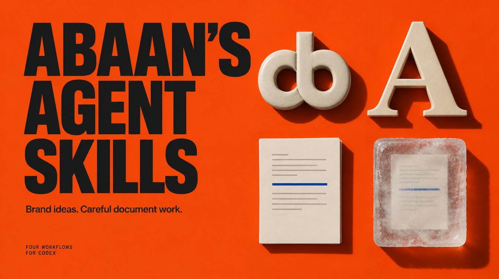
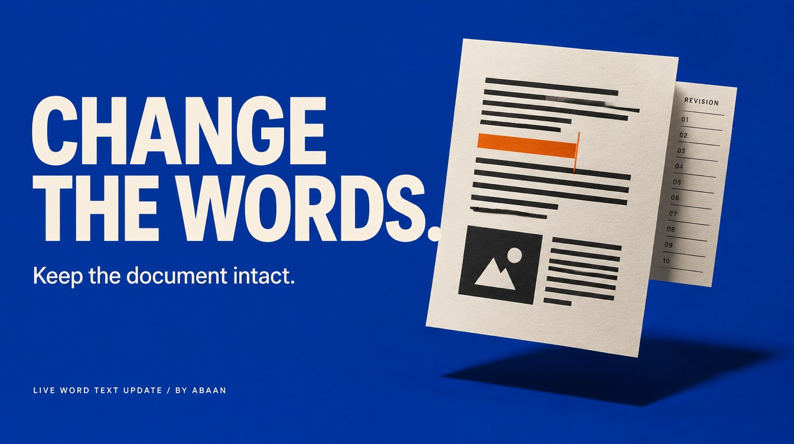

# Abaan's Agent Skills for Codex



Four open-source Codex skills for brand design and document work. Explore logo concepts, compare brand fonts, update a shared Word document or freeze a Product Document as a PDF. Each skill includes its own instructions, examples and MIT license; install the ones you need.

[Download the latest release](https://github.com/Abaans/abaans-agent-skills/releases/latest) · [Install in Codex](#install-in-codex) · [What we tested](docs/VERIFICATION.md)

## Choose a skill

| Skill | What it does | Requirements |
|---|---|---|
| [Logo concept generation](skills/logo-concept-generation/README.md) | Develop wordmarks, monograms and logo prompts; generate or critique concepts when requested | Reference access; image tools for generation |
| [Brand font exploration](skills/brand-font-exploration/README.md) | Research font licensing and compare brand typography | Web access; optional Font Book and Figma |
| [Live Word text update](skills/live-word-text-update/README.md) | Edit shared Word text while preserving history and embedded content | Word range editing and cloud reopen access |
| [Freeze a Product Document](skills/freeze-pd/README.md) | Export a saved Word revision to PDF; optionally verify a Jira attachment | Word PDF export; optional Jira access |

<table>
<tr>
<td width="50%"><a href="skills/logo-concept-generation/README.md"></a></td>
<td width="50%"><a href="skills/brand-font-exploration/README.md"></a></td>
</tr>
<tr>
<td width="50%"><a href="skills/live-word-text-update/README.md"></a></td>
<td width="50%"><a href="skills/freeze-pd/README.md"></a></td>
</tr>
</table>

## Try a request

```text
Use $logo-concept-generation to propose three monochrome directions for “Northline”, a fictional outdoor journal. Prompts only.

Use $brand-font-exploration to research serif fonts for “Northline”. Give me a licensed shortlist; do not install anything.

Use $live-word-text-update to apply this revised section to the specified shared Word document. Preserve its title, revision history and embedded diagrams.

Use $freeze-pd to export the specified Product Document as a dated PDF. Keep it local; no attachment or message.
```

Each skill includes fictional examples and review cases in its own `references/examples.md`.

## Install in Codex

Download the [release ZIP](https://github.com/Abaans/abaans-agent-skills/releases/latest) and extract it, or clone `https://github.com/Abaans/abaans-agent-skills.git`. Open a terminal in the repository folder. Copy the **complete folder** of a selected skill into your Codex skills directory. This example refuses to replace an existing installation:

```sh
python3 - <<'PYCODE'
import os
import shutil
from pathlib import Path

name = "logo-concept-generation"  # choose one of the four skill folder names
source = Path("skills") / name
codex_home = Path(os.environ.get("CODEX_HOME", str(Path.home() / ".codex"))).expanduser()
destination = codex_home / "skills" / name
if not (source / "SKILL.md").is_file():
    raise SystemExit("Run from the repository root with a valid skill name.")
if destination.exists() or destination.is_symlink():
    raise SystemExit("An installation already exists; review and back it up before replacing it.")
destination.parent.mkdir(parents=True, exist_ok=True)
shutil.copytree(source, destination)
print(destination)
PYCODE
```

Refresh skill discovery or start a new chat, then invoke the skill by its `$name`. Install only the workflows you need. To update, compare and preserve local changes before replacing that exact folder. To uninstall, remove only that installed skill folder.

These are `SKILL.md` packages. Another agent may read them, but its tool capabilities, skill discovery and approvals need separate verification. No hooks, background services or credential setup are installed by copying them.

## Scope and compatibility

The workflows describe observable outcomes and preservation rules. They do not bundle a browser driver, Word automation, Jira credentials, font files or an image model.

Font Book and Word UI instructions describe macOS routes. Research and prompt work can run elsewhere; desktop execution on another platform must be verified with the tools available there. A request for recommendations does not require a font installation. A local PDF request does not require a Jira upload.

Packaging validation and isolated installation-copy checks are automated. No end-to-end Figma, Word cloud-save or Jira upload certification is claimed by those checks. See [verification](docs/VERIFICATION.md).

## Development

Use Python 3.10 or later in an isolated environment with [development requirements](requirements-dev.txt). After creating and activating that environment, install them with `python3 -m pip install -r requirements-dev.txt`, then run:

```sh
python3 -m unittest discover -s tests -v
python3 tools/validate.py
```

The repository workflow runs local structural checks only; it does not access user accounts. See [contributor guidance](AGENTS.md).

## Questions

### Do I need all four skills?

No. Each folder works independently and carries its own references and license.

### Does this include fonts, an image generator or Word automation?

The package supplies agent instructions. Your Codex session supplies the tools and account access. Font binaries, client documents and credentials are not bundled.

### Can I use these with another AI agent?

Another agent can read the Markdown instructions. You need to check its skill discovery, tools and approval rules; this release's installation checks target Codex.

### Where is the download skill?

[Download Anything](https://github.com/Abaans/download-anything) is a separate repository for downloading supported files, videos and audio.

## For agents and maintainers

[skills.json](skills.json) lists skill names, paths, prerequisites and documentation URLs. [llms.txt](llms.txt) is a short index of the public documentation. Use each `SKILL.md` as the workflow source; consult [verification](docs/VERIFICATION.md) for the tested scope.

Report a reproducible problem through [GitHub Issues](https://github.com/Abaans/abaans-agent-skills/issues), omitting private documents, credentials and account links.

## License

[MIT](LICENSE). Maintained by Abaan. See [attribution](ATTRIBUTION.md) for third-party boundaries.
