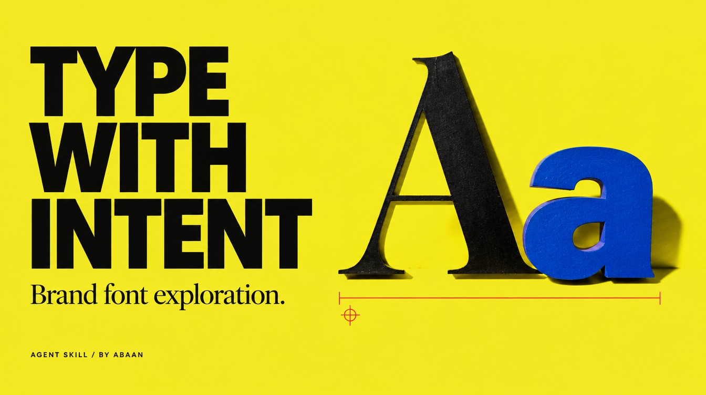

# Brand font exploration



Research brand typography, check the relevant font license and compare a shortlist on the actual brand name.

## Use it in Codex

```text
Use $brand-font-exploration to research serif fonts for Northline. Commercial desktop use matters. Give me a shortlist without installing anything.
```

A sourced font comparison with separate license, installation and rendering states. Research-only work never requires installation.

## Requirements

- Web access to foundry or distributor sources.
- Font Book on macOS and Figma Desktop for the optional installation route.

## Install

Copy this complete `brand-font-exploration` folder into your Codex skills directory. Keep its references and license together. The [repository installation guide](https://github.com/Abaans/abaans-agent-skills#install-in-codex) includes a copy command that refuses to replace an existing installation.

Read the [skill instructions](SKILL.md) and [examples](references/examples.md) before running the workflow.

## Verification

Packaging and isolated-copy tests pass. Live-account execution needs its own scoped test; package checks do not certify Word, Figma, Jira or image-generation results.

[MIT license](LICENSE). By [Abaan](https://github.com/Abaans).
