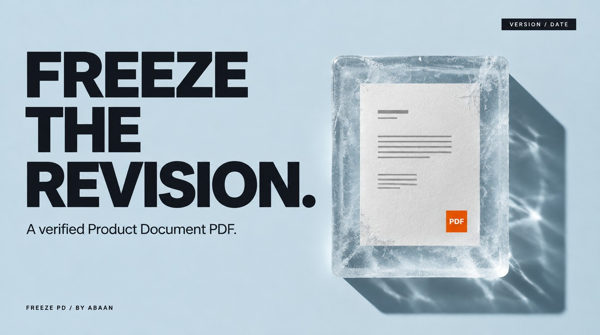

# Freeze a Product Document



Export the latest saved Product Document from Word to a dated PDF, inspect it and attach it to Jira only when requested.

## Use it in Codex

```text
Use $freeze-pd to export the specified Product Document revision as a dated PDF. Keep it local.
```

An inspected PDF with the revision and date, or a verified Jira attachment when requested. A freeze records a revision; stakeholder approval remains separate.

## Requirements

- Microsoft Word PDF export and source-document access.
- Authorized Jira upload and retrieval only for an attachment request.

## Install

Copy this complete `freeze-pd` folder into your Codex skills directory. Keep its references and license together. The [repository installation guide](https://github.com/Abaans/abaans-agent-skills#install-in-codex) includes a copy command that refuses to replace an existing installation.

Read the [skill instructions](SKILL.md) and [examples](references/examples.md) before running the workflow.

## Verification

Packaging and isolated-copy tests pass. Live-account execution needs its own scoped test; package checks do not certify Word, Figma, Jira or image-generation results.

[MIT license](LICENSE). By [Abaan](https://github.com/Abaans).
