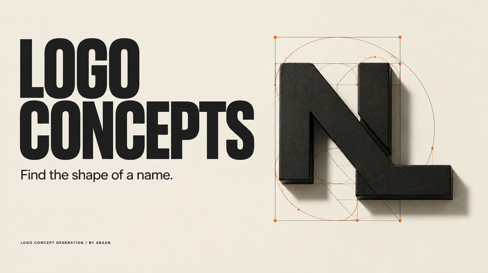

# Logo concept generation



Create logo directions with explicit lettering structure, then generate or critique concepts at the stage you request.

## Use it in Codex

```text
Use $logo-concept-generation to propose three monochrome wordmark directions for Northline, a fictional outdoor journal. Prompts only.
```

Direction cards, usable prompts or inspected concept images, depending on your request. Generated raster images still need vector construction before production.

## Requirements

- Web and visual-reference access for research.
- Image generation and inspection for requested concepts.

## Install

Copy this complete `logo-concept-generation` folder into your Codex skills directory. Keep its references and license together. The [repository installation guide](https://github.com/Abaans/abaans-agent-skills#install-in-codex) includes a copy command that refuses to replace an existing installation.

Read the [skill instructions](SKILL.md) and [examples](references/examples.md) before running the workflow.

## Verification

Packaging and isolated-copy tests pass. Live-account execution needs its own scoped test; package checks do not certify Word, Figma, Jira or image-generation results.

[MIT license](LICENSE). By [Abaan](https://github.com/Abaans).
